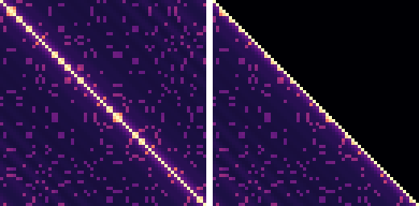

## Attention: one transformer head, flash-attention style

`examples/attention.py` computes **softmax(Q Kᵀ / √d) V** for one head the way the forward pass
of Triton tutorial 06 ("Fused Attention") does, simplified: each program keeps `BLOCK_M` query
rows in registers and walks the keys and values in blocks of `BLOCK_N`. Every block costs two
`tl.dot`s (Q Kᵀ on a transposed load of K, then P V), and the softmax is computed online: a
running row maximum `m_i` and row sum `l_i` rescale the accumulator (`alpha = exp2(m_i - m_ij)`)
whenever the maximum grows, so the N × N score matrix never reaches memory. One division by
`l_i` normalises at the end. As in the tutorial the key loop is an inlined `@jit` helper,
`_attn_fwd_inner`, run in two stages: blocks that need no mask, then, only where needed, the
blocks on the causal diagonal or past a ragged `N_CTX`, with `tl.where(..., -inf)` masks.
Grid axis 1 walks heads through the `stride_*h` arguments; K can be stored `[N, d]` or
pre-transposed `[d, N]` through two strides.



*With V = I the kernel's output is the attention matrix itself (64 tokens, d = 64, full and
causal, strict emulator; each row scaled to its maximum, square-root colour scale). The queries
and keys are half sinusoidal position encoding (the diagonal band) and half the embedding of one
of eight random tokens (the dots: tokens attending to other copies of themselves).*

### What it shows about the compiler

* **Two dots, one on a computed tile.** P = exp2(S − m) is never loaded: `tl.dot(p, v, acc *
  alpha[:, None])` broadcasts lanes of a register tile produced by `exp2`, while V streams through
  the pipelined TMU loads. The accumulator rescale is fused into the dot's accumulator operand.
* **Transposes are free in a load.** Kᵀ is a `[d, BLOCK_N]` pointer tile (`offs_n[None, :] *
  stride_kn + offs_d[:, None]`): each 16-lane TMU gather picks one element of 16 keys. Loading K
  row-major and writing `tl.dot(q, tl.trans(k))` instead runs out of registers at every tile
  tried (d = 32: 4×16, 2×32; d = 16: 4×16): `tl.trans` needs the whole loaded K tile and its
  transpose in registers, where the transposed load streams Kᵀ rows from the TMU into the dot.
  Pre-transposed K (`stride_kn = 1`, `stride_kk = N`) makes the
  same gathers contiguous and gives bit-identical outputs; the Pi run times both.
* **Register pressure decides the tile.** There is no spilling; with contiguous strides
  specialised (as the Pi build does, `compile_attention`) the largest tiles that allocate are:

  | head dim | full | causal | do not fit |
  |---|---|---|---|
  | 32 | 4×16, 2×64, 1×64 | 2×32, 1×64 | 8×16, 4×32, 1×128 (causal: 4×16, 2×64) |
  | 64 | 2×32, 1×64 | 2×16, 1×64 | 4×16, 2×64 (causal: 2×32) |

  A `[BLOCK_M]` row statistic is one register per row (each row's value in all 16 lanes), so
  `m_i`, `l_i` and `alpha` cost `3·BLOCK_M` registers next to the Q tile (`BLOCK_M·d/16`), the
  accumulator (the same again) and the score tile (`BLOCK_M·BLOCK_N/16`). Runtime strides cost
  more: with every stride a runtime argument only 16×2×16 fits; d = 32, 2×16 fits once
  `stride_kk = 1` is specialised (as `kernel[grid](...)` does for integers equal to 1), and 2×32
  needs `stride_kn` and `stride_vn` constant too (the loop's pointer increments).
* **Where the instructions go.** At d = 32, 4×16 (64 query-key pairs per iteration) the loop
  without the softmax (the two dots and their loads only) is 574 instructions, with it 958 (single
  stage): the online softmax costs as much as a dot. Per iteration and row it runs two lane
  reductions (max, sum) and an `exp2` of `alpha` on a register whose 16 lanes all hold that row's
  value, besides `exp2` of the score tile. The Q Kᵀ dot has `N = BLOCK_N`, so at `BLOCK_N = 16`
  each lane broadcast feeds one 16-lane multiply-add (and needs a register move into an
  accumulator first). Per query-key pair the full loop is 12.7 instructions at d = 32 (2×32) and
  21.8 at d = 64 (2×32), against 2d/16 = 4 and 8 multiply-adds; packing the per-row `exp2` into
  one register would save 5-10% of the loop, which the compiler does not do yet.
* **The instruction cache.** Of the Pi tiles only d = 32, 2×16 (loops of 465 instructions,
  causal 459 and 468) fits the ~500-instruction QPU instruction cache; the others stream their
  loop from L2 every iteration. So the Pi run sweeps the tiles rather than trusting the
  emulator's issue-bound estimate, which does not model fetch stalls. The firmware is built with
  the default pairing schedules (`PITON_PAIR`); the estimates below are of `PITON_PAIR=0` builds
  (same outputs bit for bit, slightly different loops):

  | d, mask, tile | loop, firmware build | loop, `PITON_PAIR=0` | emulator GFLOPS, N = 256, `PITON_PAIR=0` |
  |---|---|---|---|
  | 32, full, 2×32 | 838 | 810 | 6.94 |
  | 32, full, 2×16 | 465 | 470 | 6.01 |
  | 32, full, 4×16 | 935 | 935 | 5.65 |
  | 32, full, 2×64 | 1568 | 1561 | 7.15 |
  | 32, causal, 2×32 | 815 + 844 | 782 + 871 | 5.73 |
  | 32, causal, 2×16 | 459 + 468 | 465 + 475 | 5.26 |
  | 64, full, 2×16 | 828 | 812 | 7.04 |
  | 64, full, 2×32 | 1496 | 1392 | 8.17 |
  | 64, causal, 2×16 | 837 + 845 | 855 + 882 | 5.85 |

  (62.5 M instructions/s per QPU, no fetch stalls. Causal kernels have two loops, the unmasked
  stage and the diagonal; their GFLOPS count half the N² pairs, as tutorial 06 does, while the
  diagonal blocks compute all of theirs.)

* **Numerics.** Against float64 numpy the round-toward-zero QPU result is within 5·10⁻⁶ at
  N = 512 (outputs of magnitude ≤ 1). Where the arithmetic is exact the result is too: with one
  matching key per query (scores differing by 255 after scaling) every other weight underflows to
  exactly 0 and the output is the matched value row up to the final division (PIton's `x / 1.0`
  is 2 ulp toward zero); causal rows are bit-identical whatever the future keys hold, and the
  two K layouts give the same bits.

### Running it

```bash
.venv/bin/python examples/attention.py                    # emulator preview -> docs/images/attention-weights.png
.venv/bin/python -m pytest tests/test_attention.py -q      # emulator + harness tests (~2 min)
.venv/bin/python examples/attention_pi.py --dry-run        # compile 13 kernels (~2 min, 4 at a time), build the firmware, parse a synthetic log
.venv/bin/python examples/attention_pi.py                  # build, boot, check, time on the Pi
```

The Pi run (`pi/examples/attention`) generates the inputs on the board (the `piton_rt.h` LCG,
mirrored on the host; Q scaled by 4 so scores have a standard deviation near 1.3), computes every
problem with the ARM baseline, then runs each of the 33 cases on the QPUs: every output is
checked against the ARM (`|Δ| ≤ 5·10⁻⁵ + 10⁻⁴·|ref|`) before and after timing, and a sample (all
of the V = I case) is checked on the host against float64 numpy with the same bound. Cases: the
tiles of `PI_TILES` for d = 32 and 64, full and causal, at N = 128, 256 and 512; N = 499 (ragged,
masked tails); pre-transposed K at N = 512; and the 64-token V = I picture
(`docs/images/attention-pi-weights.png`). Results: `benchmarks/results/attention-pi-<date>.{json,log}`.

* **ARM baseline:** `pi/examples/attention/arm_attention.c`, straightforward C (per query row: all
  scores, max, exp, sum, the weighted sum of V rows), `-O3`, data cache on, VFP RunFast, one core
  at 700 MHz. Not blocked or vectorised.
* **Timing:** the whole launch call (uniform writes, GPU cache clear, queue, wait), median of
  five, inputs resident in GPU memory. GFLOPS count the two matrix products, 4N²d, halved when
  causal, as tutorial 06 does; the softmax is not counted.

### Results on the Pi Zero W

| d | N | mask | best tile | QPU | GFLOPS | ARM C | speedup |
|---|---|---|---|---|---|---|---|
| 32 | 128 | full | 2×16 | 0.70 ms | 2.99 | 30.9 ms | 44.0× |
| 32 | 512 | full | 4×16 | 10.1 ms | 3.31 | 526 ms | 51.9× |
| 32 | 512 | causal | 2×16 | 5.31 ms | 3.16 | 258 ms | 48.6× |
| 64 | 512 | full | 2×16 | 24.6 ms | 2.72 | 1318 ms | 53.5× |
| 64 | 512 | causal | 2×16 | 14.7 ms | 2.29 | 592 ms | 40.4× |

Tile sweep at d = 32, N = 512 (full): 2×32 11.5 ms (2.91 GFLOPS), 2×16 15.4 ms (2.17), 4×16 10.1 ms (3.31),
2×64 40.0 ms (0.84).
K pre-transposed vs gathered (d = 32, N = 512): 2×32 10.9 vs 11.5 ms (1.06×), 2×16 9.1 vs 15.4 ms (1.69×; 3.68 GFLOPS,
57.7× the ARM, the fastest case). Ragged N = 499 (d = 32, 2×32): 12.4 ms full (40.1×), 7.4 ms causal (33.1×).
Largest error against float64 on the board's samples: 4.1·10⁻⁶; every output of every case also matched the ARM
reference on the board, before and after timing. Measured 2026-11-05 (`benchmarks/results/attention-pi-2026-11-05.{json,log}`).
