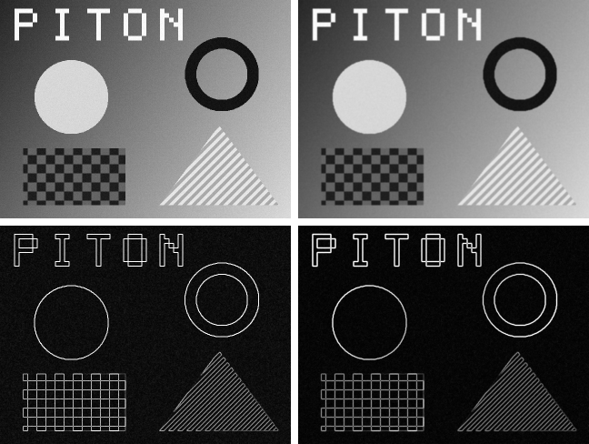

# Image filters: Gaussian blur and Sobel edges

`examples/image_filters.py` runs two classic image filters as tiled 2-D Triton stencils on the
QPUs: a binomial **Gaussian blur** (3×3 `[1 2 1]/4` per axis, or 5×5 `[1 4 6 4 1]/16`) and the
**Sobel gradient magnitude** `sqrt(gx² + gy²)`, plus the two **fused** (blur, then Sobel, in one
5×5 stencil). The test image is a 640×480 grayscale scene (gradient, checkerboard, disc, ring,
striped triangle, the word PITON, ±8 of noise). It is drawn with integer arithmetic only, so the
Pi generates it on the board (`pi/examples/image_filters/scene.h`) and nothing large goes over
the UART.



*Input, 5×5 blur (top); Sobel, 3×3 blur fused into Sobel (bottom), at half size. Edge
magnitudes are scaled by 255/400.* Enlarged crop, same order:


These images come from the host model. The Pi's outputs are the same bits: every output row is
hashed on the board and compared with the model. `--dump-images` also reads two images back from
the board.

## The kernels

Program (i, j) of the grid `(cdiv(W, BLOCK_W), cdiv(H, ROWS))` covers a `BLOCK_W`-wide strip
of `ROWS` rows. A runtime loop walks the strip in `BLOCK_H × BLOCK_W` tiles, so the code stays
small and a VGA image needs 200-400 programs instead of thousands. Each stencil tap is one
`tl.load` of the whole tile, shifted by (dy, dx), and the stores are masked to the image.

| filter | kernel | loads / pixel | QPU instructions | executed / pixel (emulator) |
|---|---|---|---|---|
| `blur3` | `blur_kernel`, RADIUS=1, 4×16 tiles | 9 | 372 | 3.7 |
| `blur3_zero` | the same with BORDER=ZERO (masked loads), 2×16 | 9 | 460 | 10.1 |
| `blur5` | `blur_kernel`, RADIUS=2, 2×16 | 25 | 435 | 9.0 |
| `blur5_separable` | `blur_pass_kernel` along rows, then along columns | 10 | 285 + 358 | 5.8 |
| `blur5_rolling` | `blur_rolling_kernel`: one row per iteration, 1×32 | 5 | 363 | 2.5 |
| `sobel` | `sobel_kernel`, 4×16 | 8 | 505 | 5.7 |
| `sobel_rolling` | `sobel_rolling_kernel`, FUSED=False, 1×32 | 3 | 273 | 2.9 |
| `blur_sobel` | `blur_sobel_kernel`: 3×3 blur fused into Sobel, 5×5 taps, 2×16 | 24 | 576 | 13.0 |
| `blur_sobel_rolling` | `sobel_rolling_kernel`, FUSED=True, 1×16 | 5 | 315 | 5.2 |

Borders are **clamped** by default (OpenCV's `BORDER_REPLICATE`, scipy's `mode="nearest"`).
`BORDER=ZERO` reads 0 outside the image through masked loads with `other=0.0` (blur and Sobel
kernels only).

## What it shows about the compiler

* **The textbook Triton stencil compiles, but loop-carried tensors are what make it fast.** The
  rolling kernels keep the last four horizontally filtered rows in registers
  (`h0, h1, h2, h3 = h1, h2, h3, h4` in a runtime `for`), so each row is loaded and filtered once.
  On the emulator that is 2.5 executed instructions per pixel for the 5×5 blur instead of 9.0
  (direct) or 5.8 (two separable passes through memory), and 5.2 for blur + Sobel instead of 13.0.
* **Clamping is cheaper than masking on the QPU.** Clamping the *row offset*
  (`clamp(rows * stride, 0, (H - 1) * stride)`) keeps the address affine in the program id. Only
  a min/max per register is left, and the column clamps are loop-invariant and hoisted. The 2-D
  masks of `BORDER=ZERO` cost 2.7× the executed instructions (10.1 vs 3.7 per pixel), and the
  fused 5×5 stencil with masks does not fit the registers at all.
* **Exact arithmetic despite round-toward-zero.** The weights are small integers and the image
  holds integers 0..255. Every partial sum is therefore an exact float32 integer, and the
  power-of-two normalisations are exact. All three 5×5 blurs give the same bits as numpy, in any
  summation order, and the fused blur + Sobel equals blur then Sobel bit for bit away from the
  2-pixel border. For Sobel only the square root differs from numpy: PIton's ALU `tl.sqrt` is
  within 4 ulp of the correctly rounded result (mean ~1 ulp). The host model therefore runs
  PIton's own sqrt on the emulator, once per distinct value (10,000-55,000 per VGA image). The
  model is bit-exact for every filter.
* **`x * 1` and `0 + x` are not no-ops on the QPU** (a −0 or denormal result becomes +0), so
  the compiler keeps them. The kernels leave out weight-1 multiplies and zero-initialised sums.
* **Where the stores may cap it** (an expectation from `perf/README.md`'s store-engine model,
  TBD (Pi)). One VDW DMA engine serves all 12 QPUs, at about 0.18 µs per DMA plus 0.85 ns per
  byte. A rolling kernel stores one image row per iteration: a 128-byte DMA at `BLOCK_W=32`, 64
  bytes at 16. The 4×16 tiles store 256 bytes per DMA. Wider rolling strips do not fit the
  registers, because the five clamped column offsets are loop-invariant and stay live.

## Running it

```bash
.venv/bin/python examples/image_filters.py                 # 160x120 emulator previews in build/
.venv/bin/python -m pytest tests/test_image_filters.py -q   # emulator, models, firmware on the host
.venv/bin/python examples/image_filters_pi.py --dry-run     # everything except the boot (~30 s)
.venv/bin/python examples/image_filters_pi.py               # build, boot, verify, save (~1 min)
.venv/bin/python examples/image_filters_pi.py --dump-images # + read two images back (~2 more min)
```

One boot runs everything. Every QPU filter first runs on a small ragged image (83×61), then on
the full image: once for setup, once checked, and `--repeats` (5) timed runs with the ARM
caches off plus 5 with the ARM instruction cache on (the ARM side of the launch). Then the ARM
baselines run with the L1 caches on. Each is checked against the QPU output and timed. The run
fails unless:

* every row hash of every QPU output at both sizes equals the host model;
* the filters with the same output agree bit for bit on the board;
* the ARM blurs equal the QPU's bits, and the ARM Sobel images (VFP `vsqrt`) are within 8 ulp.

The strict emulator also reproduces the model bit for bit at the check size before the boot.
Results go to `benchmarks/results/image_filters-pi-<date>.{json,log}`.

**ARM baselines** (`pi/examples/image_filters/arm_filters.c`, straightforward C, `-O3`, VFP,
MMU and L1 caches on) are the direct 2-D stencils (clamped taps), the separable 5×5 blur (a row
pass and a column pass, clamping only at the edges) and blur then Sobel as two passes.

## Results on the Pi Zero W

TBD (Pi): 640×480, median of 5, QPU time is the whole launch call; ARM 700 MHz, V3D 250 MHz.

| output | best QPU filter | QPU ms | Mpixel/s | ARM direct ms | best ARM ms | speedup vs best ARM |
|---|---|---|---|---|---|---|
| 3×3 blur | TBD (Pi) | TBD (Pi) | TBD (Pi) | TBD (Pi) | TBD (Pi) | TBD (Pi) |
| 5×5 blur | TBD (Pi) | TBD (Pi) | TBD (Pi) | TBD (Pi) | TBD (Pi) | TBD (Pi) |
| Sobel | TBD (Pi) | TBD (Pi) | TBD (Pi) | TBD (Pi) | TBD (Pi) | TBD (Pi) |
| blur + Sobel | TBD (Pi) | TBD (Pi) | TBD (Pi) | TBD (Pi) | TBD (Pi) | TBD (Pi) |

Per filter (direct vs separable vs rolling, clamp vs zero border): TBD (Pi).

## Files

| file | what |
|---|---|
| `examples/image_filters.py` | the kernels, the scene, the numpy models, PNG output |
| `examples/image_filters_pi.py` | builds the firmware, checks the model on the emulator, boots, verifies, saves |
| `pi/examples/image_filters/` | `main.c` (the benchmark), `arm_filters.c` (ARM baselines), `scene.h`, `row_hash.h` |
| `tests/test_image_filters.py` | emulator vs model for every filter, borders, strides, tiny images, the C twins, the firmware on the host, log rejection |
