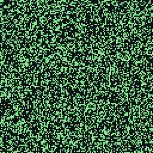
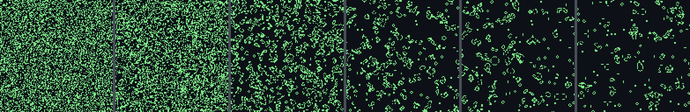

# Conway's Game of Life



`examples/life.py` runs Life on a torus (row 0 neighbours the last row, column 0 the last
column) as three Triton kernels, one launch per generation from `src` into `dst`. On the Pi,
`examples/life_pi.py` evolves a random 512 x 512 soup for 256 generations with each kernel and
with three C versions on the ARM, checks every generation of every implementation against numpy,
and times them.

| kernel | how it counts the 3 x 3 neighbourhood | QPU instructions | executed per cell (emulator) |
|---|---|---|---|
| `life_kernel` (`qpu_tile`) | the textbook stencil: nine shifted loads of a 4 x 16 tile of int32 cells, rule with `tl.where` | 457 | 5.6 |
| `life_rows_kernel` (`qpu_rows`) | a 64-column strip walks 32 rows, carrying the horizontal 3-cell sums of the previous two rows: 3 loads per cell | 329 | 1.9 |
| `life_bits_kernel` (`qpu_bits`) | 32 cells per uint32 word, counts added bit-sliced (and/or/xor, shifts): one instruction covers 512 cells | 210 | 0.14 |

The instruction counts and the per-cell counts are for the Pi configurations at 512 x 512
(`python examples/life_pi.py --build-only` prints the first).



## What it shows about the compiler

* **Wrap-around with `tl.where` on indices.** The torus is `tl.where(rows == 0, n_rows - 1, rows - 1)`
  and the like, on the row and column index vectors; the row offsets are multiplied by the runtime
  stride once (`mid = rows * stride`, then `mid - stride` / `mid + stride`).
* **Masks only where they are needed.** Indices are clamped into the grid (`tl.minimum`), so the
  nine loads are unmasked TMU gathers and only the store is masked. Written the other way (masked
  loads, three row multiplies) the same kernel executes 2.7x the instructions per cell; with `%`
  for the wrap, 1.6x (emulator, 1 x 64 tiles at 128 x 128).
* **A 1-D launch grid lets the compiler coarsen.** `life_kernel` maps `tl.program_id(0)` to a tile
  with `//` and `%`, as the Triton matmul tutorial does. With a 2-D grid every 4 x 16 tile would be
  its own hardware program (4,096 per generation, about 0.74 us each to issue); with the 1-D grid
  PIton runs 4 consecutive tiles per program.
* **Loop-carried values and tuple swaps.** `life_rows_kernel` and `life_bits_kernel` carry the row
  sums (and the row pointer, wrapped with `tl.where` on the pointer itself) through a runtime
  `for` loop and rotate them with `h_up, h_mid, alive = h_mid, h_down, below`.
* **Integer and bit operations.** `life_bits_kernel` is all `&`, `|`, `^`, `~` and shifts on uint32
  (`>>` is logical), with an inlined `@triton.jit` helper that returns a tuple of bit planes.
* **Register limits.** There is no spilling: `life_kernel` fits a 4 x 16 or 2 x 32 tile but not
  4 x 32 (`RegAllocError`), `life_rows_kernel` a 64-column strip but not 128.

## What the Pi run checks and measures

* `arm_naive` runs 256 generations of the soup (generated on the board from the `piton_lcg`
  generator; `soup()` is its numpy twin): the reference. Every other implementation runs the same
  256 generations; after each one the board compares its population and a hash of the packed grid
  with `arm_naive`'s, and the final grids cell by cell. The host compares every implementation's
  256 (population, hash) pairs with numpy, 65 crops (128 x 128, every 4th generation, read back
  from `qpu_tile`) and the full final grid.
* Timing: three repeats of 100 generations per implementation, ping-pong buffers, nothing else in
  the loop; the grid after the 300 generations is checked against numpy too. QPU time is each
  launch in full (uniforms, cache clears, queueing, waiting), with the ARM caches off as in every
  PIton benchmark.
* ARM baselines (`pi/examples/life/life_arm.c`, gcc -O3, MMU and L1 caches on): `arm_naive` (eight
  neighbour loads per cell, wrap by compare and select), `arm_rows` (vertical 3-cell sums once per
  row, then horizontal: the `qpu_rows` algorithm) and `arm_bits` (the `qpu_bits` adder on packed
  words). Each QPU kernel is compared with the same algorithm on the ARM and with the fastest ARM
  code, which is `arm_bits`.
* A second phase runs `qpu_bits` and `arm_bits` on a 2048 x 2048 torus (4.2 M cells, 512 KiB per
  buffer): 64 checked generations, then 3 x 64 timed.

## Results (Pi Zero W, ARM 700 MHz, V3D 250 MHz)

| implementation | torus | time per generation | cell updates / s | vs same algorithm on the ARM | vs fastest ARM |
|---|---|---|---|---|---|
| `qpu_tile` | 512 x 512 | 4,992 us | 52.5 M | 4.17x (`arm_naive`) | 0.16x |
| `qpu_rows` | 512 x 512 | 1,791 us | 146 M | 8.42x (`arm_rows`) | 0.43x |
| `qpu_bits` | 512 x 512 | 161 us | 1,626 M | 4.81x (`arm_bits`) | **4.81x** |
| `arm_naive` | 512 x 512 | 20,804 us | 12.6 M | | |
| `arm_rows` | 512 x 512 | 15,088 us | 17.4 M | | |
| `arm_bits` | 512 x 512 | 776 us | 338 M | | |
| `qpu_bits` | 2048 x 2048 | 2,279 us | 1,841 M | **5.77x** (`arm_bits`) | |
| `arm_bits` | 2048 x 2048 | 13,145 us | 319 M | | |

Measured 2026-11-05 on the Pi Zero W; every generation of every implementation matched numpy. Medians of three
repeats; raw log and every number in `benchmarks/results/life-pi-2026-11-05.{json,log}`. The QPU's best, the
bit-sliced kernel, updates 1.6-1.8 G cells/s, 4.8-5.8x the same bit-sliced algorithm on the ARM; the
straightforward stencils are 4-8x their ARM twins but slower than the ARM's bit-sliced code.
The emulator's timing model puts one 512 x 512 generation at about 900 us (`qpu_tile`), 300 us
(`qpu_rows`) and 22 us (`qpu_bits`, plus launch overhead); it does not model the TMU or the DMA
engine exactly, so these are estimates only.

Frames read back from the Pi (after the run): `docs/images/life-pi-anim.gif`,
`life-pi-strip.png` and `life-pi-final.png`.

## Running it

```bash
.venv/bin/python examples/life.py                    # 8 generations of a small soup, all kernels, emulator
.venv/bin/python examples/life.py --images           # docs/images/life-{soup.gif,strip.png,final.png} (numpy)
.venv/bin/python -m pytest tests/test_life.py -q     # emulator vs numpy, firmware C, log checks (~35 s)
.venv/bin/python examples/life_pi.py --build-only    # compile the kernels, build the firmware, emulate it
.venv/bin/python examples/life_pi.py --dry-run       # also run the firmware natively (ARM code in place
                                                     # of the QPU) and check its log; no Pi needed
.venv/bin/python examples/life_pi.py                 # the Pi run: ~1 min emulator check + ~2 min on the board
```

Every mode first runs the kernels it just compiled for one generation of the 512 x 512 and
2048 x 2048 tori in the strict emulator (`--skip-emulator` skips it): the compiler's output is not
always the same from one compile to the next (451-457 instructions for `life_kernel`), so the
check is of the code that goes into the firmware.

`--size`, `--gens`, `--timed-gens`, `--repeats`, `--big` (0 skips the 2048 x 2048 phase) and the
tile shapes (`--tile 4x16`, `--rows-tile 32x64`, `--bits-tile 16x16`) are options. Most of the Pi
run is the UART: about 280 KB of log, most of it the 65 crops and the final grid.
